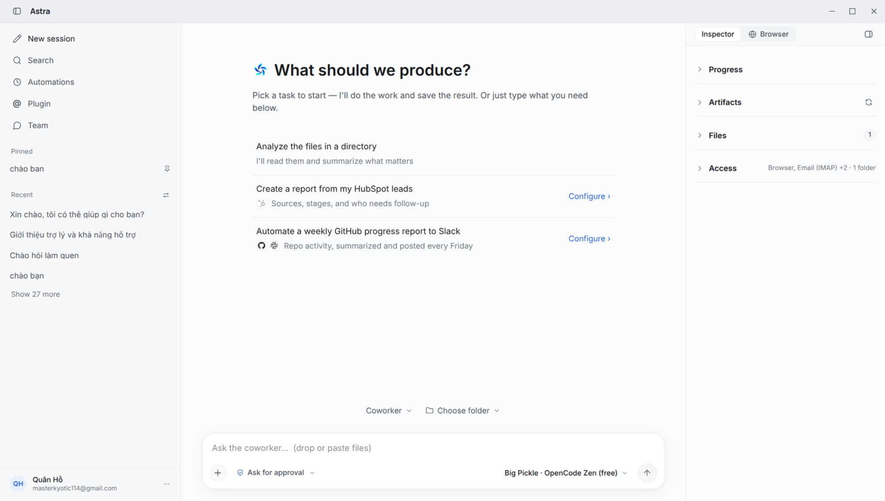

<p align="center">
  
</p>

<h1 align="center">Astra</h1>

<p align="center">
  <strong>Autonomous, Local-First Desktop AI Coworker Platform</strong><br>
  Governed execution · Multi-agent teams · Native desktop shell · 100% sovereign privacy
</p>

<p align="center">
  
  <a href="LICENSE"></a>
  
  
  
</p>

---

**Astra** is an open-source, local-first desktop AI coworker designed to deliver **finished work**, not just conversation. Running directly on your machine, Astra reviews code, audits systems, drafts deliverables, coordinates multi-agent teams, and interacts with your files, shell, and external tools—all governed by strict architectural safety boundaries.

Bring your own API keys (OpenAI, Anthropic, Google Gemini, DeepSeek, Grok, and more) or run 100% offline with local models via **Ollama**. Your code, credentials, and data never leave your workstation without your explicit permission.

<p align="center">
  
</p>

---

## 📥 Getting Astra

Astra is under active development. Installer downloads and automatic updates are temporarily paused while we prepare the release infrastructure.

You can still try it today by [running from source](#-running-from-source), or [build an installer locally](#-building-distributables-locally) for Windows, macOS, or Linux. Download links will be added here when releases resume.

---

## ✨ Key Features

### 1. Governed Execution by Design
Astra implements safety as an architectural hard floor, not a prompt suggestion:
- **Hard Floors**: Destructive file operations, unreviewed git pushes to shared branches, and credential exposure require explicit human approval.
- **Earned Autonomy**: Routine tool calls can be permitted once, granted as standing rules, or added to scoped allowlists.
- **Independent Reviewer Model**: In semi-autonomous mode, an independent reviewer model evaluates risk and pauses execution when uncertain.
- **Complete Audit Trail**: Every tool invocation, shell command, and approval state is logged with cryptographic and session provenance.

### 2. Multi-Agent Team Collaboration
- **Persistent Teammates**: Spawn and coordinate specialized agent personas (Cowork, Code, Architect, Reviewer).
- **Isolated Workspaces**: Agents operate inside per-task worktrees and scoped scratchpads without clobbering your working tree.
- **Canonical Work Pipeline**: All automations, connector events, and agent handoffs converge on a single durable state machine.

### 3. Deep Local Tooling & Integrations
- **Terminal & Files**: Controlled terminal execution, diff generation, file manipulation, and ripgrep code discovery.
- **Model Context Protocol (MCP)**: Native client support for external MCP servers, allowing you to connect private APIs, enterprise databases, and CLI utilities.
- **25+ Connectors**: Bidirectional integrations for GitHub, Slack, Jira, Notion, Linear, Google Calendar, Gmail, and Outlook.
- **Speech-to-Text Sidecar**: Native Rust voice transcription engine for hands-free dictation and interaction.

### 4. Bring Your Own Model (BYOM) & Sovereign Privacy
Switch model providers instantly per conversation or per agent:
- **Cloud Providers**: OpenAI, Anthropic, Google Gemini, xAI, DeepSeek, Qwen, Mistral, Moonshot Kimi, BytePlus Ark...
- **Local / Offline Models**: Direct integration with **Ollama** and local OpenAI-compatible endpoints with zero data egress.

---

## 🏗️ Architecture

Astra is designed around high-cohesion, cleanly decoupled subsystems:

```text
┌────────────────────────────────────────────────────────┐
│               Astra Desktop GUI (Tauri v2)             │
│   React 18 · TypeScript · Vite · Window Supervision    │
└───────────────────────────┬────────────────────────────┘
                            │ WebSocket / REST (Port 8765)
┌───────────────────────────▼────────────────────────────┐
│             Local Agent Engine (FastAPI Sidecar)       │
│  coworker/ runtime · SQLite Persistence · Permissions  │
├───────────────┬────────────────────────┬───────────────┤
│  Tools & Shell│  Multi-Agent Teams     │ Model Router  │
│  FS, Shell,   │  Coordinator, Sandbox, │ aisuite, BYOK,│
│  Git, MCP     │  Context Isolation     │ Ollama Local  │
└───────┬───────┴───────────┬────────────┴───────┬───────┘
        │                   │                    │
┌───────▼───────┐   ┌───────▼────────┐   ┌───────▼───────┐
│ Local Projects│   │ 25+ Connectors │   │ Voice Sidecar │
│ & Workspaces  │   │ Slack, GitHub, │   │ Rust STT      │
│               │   │ Jira, Notion   │   │ Sidecar       │
└───────────────┘   └────────────────┘   └───────────────┘
```

See [docs/ARCHITECTURE.md](docs/ARCHITECTURE.md) for the detailed subsystem breakdown, state machine specs, and persistence guarantees.

---

## 🚀 Running from Source

### Prerequisites
- **Python**: 3.10 or higher
- **Node.js**: 20.x or higher (npm)
- **Rust Toolchain**: `stable` (via [rustup](https://rustup.rs/))
- **Linux Packages** (Debian/Ubuntu only):
  ```bash
  sudo apt-get install -y libwebkit2gtk-4.1-dev build-essential curl wget file libssl-dev libayatana-appindicator3-dev librsvg2-dev libasound2-dev
  ```

### Step 1: Clone the Repository
```bash
git clone https://github.com/PhongTran-code/Astra_AI.git
cd Astra_AI
```

### Step 2: Bootstrap the Python Backend
```bash
# Set up Python venv and install dependencies
bash packaging/setup_dev_env.sh
```

### Step 3: Run the Development Server
**Terminal 1 — Backend API Server:**
```bash
.venv/bin/astra-server --cwd "$PWD" --host 127.0.0.1 --port 8765
```

**Terminal 2 — Desktop GUI (Tauri):**
```bash
cd surfaces/gui
npm install
npm run tauri dev
```
*(To run only the web browser interface without Tauri, use `npm run dev` instead).*

### Step 4: Preview Landing Page
To run the marketing & simulator website locally:
```bash
python3 -m http.server 3000 --directory landing
```
Visit `http://localhost:3000` or `http://localhost:3000/simulator.html`.

---

## 🧪 Testing & Verification

Astra enforces strict automated test verification:

```bash
# Run backend pytest suite (60+ tests)
.venv/bin/pytest tests -q

# Run frontend typecheck & Vitest unit tests
cd surfaces/gui
npx tsc --noEmit
npm test

# Run hermetic Playwright E2E suite
npm run e2e
```

---

## 📦 Building Distributables Locally

To package Astra for your current platform:

```bash
# Build Linux .deb and .AppImage
bash packaging/build_linux.sh

# Build macOS .dmg
bash packaging/build_dmg.sh

# Build Windows .exe and .msi (PowerShell)
.\packaging\build_windows.ps1
```

The [GitHub Actions workflow](.github/workflows/release.yml) can also be run manually to build development artifacts for macOS, Windows, and Linux. Public releases and Blob uploads remain paused.

---

## 📂 Repository Map

```text
coworker/                 Python package and agent runtime (permissions, reviewer, risk, secrets)
coworker/teams/           Team domain, contracts, persistence, routing, runtime, permissions, sandbox
coworker/server/          FastAPI application and local server/session management
coworker/providers/       Model-provider implementations and capability routing
coworker/connectors/      External integrations, identities, relays, and senders
coworker/automation/      Scheduled and event-triggered work
coworker/tools/           Governed local file, shell, git, web, MCP, and agent tools
coworker/memory/          Memory stores and memory tools
surfaces/gui/             React 18 + TypeScript GUI and Playwright E2E suites
surfaces/gui/src-tauri/   Tauri v2 desktop shell and sidecar process supervision
stt/                      Rust speech-to-text sidecar
landing/                  Product landing page and interactive simulator
packaging/                Dev bootstrap, PyInstaller specs, installers, and update manifests
tests/                    Python backend, integration, and security gate test suites
plan/                     Target architecture and implementation plans
docs/                     Architecture specifications, operational references, and decision records
```

---

## 📖 Documentation Index

- [docs/ARCHITECTURE.md](docs/ARCHITECTURE.md) — Architectural overview, work request pipelines, and safety models.
- [docs/ref/runtime.md](docs/ref/runtime.md) — Canonical reference for startup, ports, sidecars, and token handling.
- [docs/ref/debugging.md](docs/ref/debugging.md) — Debugging workflows, logs inspection, and troubleshooting.
- [AGENTS.md](AGENTS.md) — Engineering contract for AI coding assistants and contributors.
- [SECURITY.md](SECURITY.md) — Security policies, vulnerability disclosure, and hard floor invariant definitions.

---

## 🤝 Contributing

Contributions, bug reports, and feature proposals are welcome!
1. Check existing [Issues](https://github.com/PhongTran-code/Astra_AI/issues) or open a new one.
2. Ensure changes comply with the engineering contract defined in [AGENTS.md](AGENTS.md).
3. Run targeted unit tests and verify `git diff --check` before submitting pull requests.

---

## 📄 License

Astra is open-source software licensed under the [MIT License](LICENSE).
