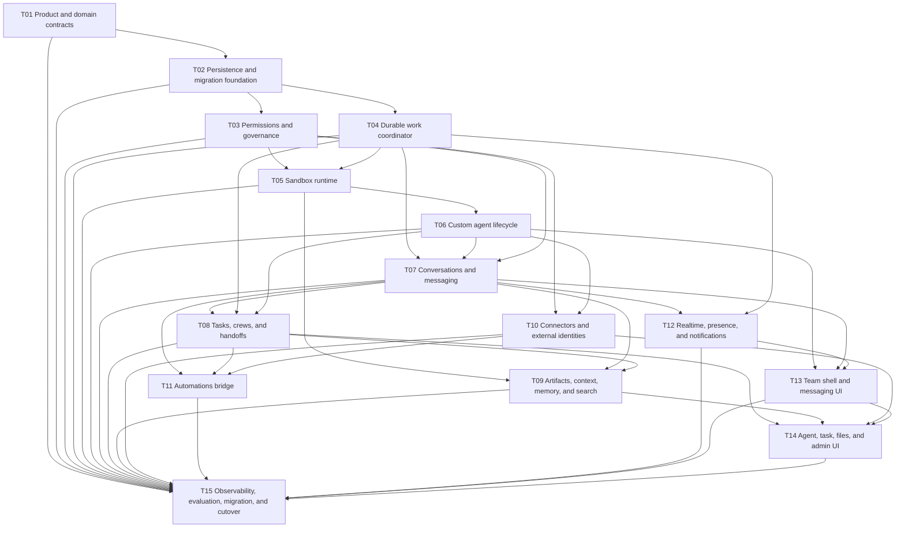

# Astra Team implementation plan

Status: complete
Scope: one complete target product, not a sequence of product versions

## Outcome

Astra gains a first-class `Team` surface directly below `Automations`. Humans and
persistent custom agents collaborate through direct messages, groups, threads,
tasks, artifacts, approvals, and automations. Every persistent agent has an
isolated sandbox and durable inbox; all entry points use one `WorkRequest`
pipeline.

This directory intentionally separates implementation work by dependency. The
task numbers are execution order, not V1/V2/V3 releases. Do not publicly ship a
partial Team surface as if it were the finished product.

## Source of truth

- Product and architecture target: [target-state.md](target-state.md)
- This file: dependency order and global completion gates
- Each task file: task-local scope, checklist, acceptance criteria, and verification

If a task decision changes a product invariant, update `target-state.md` first,
then update every affected task. Do not leave contradictory rules in multiple
files.

## Non-negotiable invariants

1. `Team` is a top-level product surface, not a child of `Automations`.
2. Persistent agents are visible teammates; ephemeral subagents remain internal.
3. Every persistent agent has its own sandbox. A group never shares one mutable
   filesystem between agents.
4. DM, group, task, automation, connector event, and agent handoff all create the
   same canonical `WorkRequest`.
5. Messages, tasks, deliveries, runs, approvals, and audit history are durable.
6. Routing is deterministic before model execution. Models may propose work, but
   the runtime enforces recipients, permissions, budgets, and state transitions.
7. Permissions are requester-aware and enforced in the backend/runtime.
8. Task dependency readiness and independent review are runtime invariants.
9. REST/query stores are the source of truth. WebSocket events provide live
   updates and must support cursor-based catch-up.
10. Delivery semantics are at-least-once with idempotency; never claim
    exactly-once execution.

## Dependency graph

## Task index

| ID | Task | Depends on | Status |
|---|---|---|---|
| T01 | [Product and domain contracts](done/task-product-domain-contracts.md) | None | Complete |
| T02 | [Persistence and migration foundation](done/task-persistence-foundation.md) | T01 | Complete |
| T03 | [Permissions and governance](done/task-permissions-governance.md) | T01, T02 | Complete |
| T04 | [Durable work coordinator](done/task-durable-work-coordinator.md) | T01, T02 | Complete |
| T05 | [Sandbox runtime](done/task-sandbox-runtime.md) | T03, T04 | Complete |
| T06 | [Custom agent lifecycle](done/task-custom-agent-lifecycle.md) | T01–T05 | Complete |
| T07 | [Conversations and messaging](done/task-conversations-messaging.md) | T02–T04, T06 | Complete |
| T08 | [Tasks, crews, and handoffs](done/task-tasks-crews-handoffs.md) | T03, T04, T06, T07 | Complete |
| T09 | [Artifacts, context, memory, and search](done/task-artifacts-context-search.md) | T05, T07, T08 | Complete |
| T10 | [Connectors and external identities](done/task-connectors-external-identities.md) | T03, T06, T07 | Complete |
| T11 | [Automations bridge](done/task-automations-bridge.md) | T04, T07, T08, T10 | Complete |
| T12 | [Realtime, presence, and notifications](done/task-realtime-presence-notifications.md) | T04, T06, T07 | Complete |
| T13 | [Team shell and messaging UI](done/task-team-shell-messaging-ui.md) | T06, T07, T12 | Complete |
| T14 | [Agent, task, files, and admin UI](done/task-agent-task-admin-ui.md) | T08–T10, T13 | Complete |
| T15 | [Observability, evaluation, migration, and cutover](done/task-observability-evals-cutover.md) | All | Complete |

## Parallel work

After T02 is stable:

- T03 and T04 may run in parallel.
- T05 and the query-only parts of T07 may run in parallel after their contracts
  are frozen.
- T09, T10, T11, and T12 may run in parallel once their upstream events exist.
- T13 can be built against contract fixtures while backend tasks finish, but the
  fixtures must be generated from the canonical API types.

## Global completion gates

- [x] No agent shares a writable project tree with another coding agent.
- [x] A process crash at each delivery/run transition causes neither silent loss
      nor unreported duplication.
- [x] Model failure cannot advance a delivery cursor as successful.
- [x] DM content cannot enter a group context without an explicit share action.
- [x] A requester cannot use another person's external identity without authority.
- [x] Task dependencies block dispatch in the runtime, not only in the UI.
- [x] A builder cannot approve its own protected task.
- [x] Every background action has a trace, budget, stop path, and visible owner.
- [x] Team views cover loading, empty, partial, full, offline, denied, error, and
      recovery states.
- [x] Existing conversations, automations, boards, and artifacts survive migration.
- [x] The complete Python, GUI unit, E2E, live E2E, migration, chaos, and safety
      suites pass. Python, GUI unit/build, hermetic GUI, live model-backed,
      migration, and chaos evidence is green; the canonical board adapter is
      active after the durable cutover marker and unsupported auxiliary legacy
      routes are fenced. The two documented skips are opt-in live vision and
      the unavailable post-approval crash hook.

## Plan lifecycle

When a task is complete:

1. Mark every acceptance item complete with evidence.
2. Update its `Status` to `complete`.
3. Move the file to `plan/done/` and update this index link.
4. Do not mark T15 complete until all global completion gates pass.
