# Astra Team target state

Status: target architecture  
Product label: `Team`

## Product definition

Astra Team is a persistent collaboration workspace where humans and isolated AI
agents work through direct messages, groups, threads, tasks, artifacts,
approvals, and automations.

The surface answers “who is doing the work and where is the shared outcome?”
`Automations` answers “when or from which event should work start?” Connectors
answer “which external systems may be used?”

## Navigation

```text
Astra
├── + New session
├── Search
├── Automations
└── Team
```

When Team is active, the sidebar body becomes:

```text
Unread | Direct | Groups | Threads

Pinned
Direct messages
Groups
```

The main Team view has a conversation pane and an optional context inspector.
The inspector shows members, current task, artifacts, approvals, and run details.

## Product concepts

| Concept | Meaning |
|---|---|
| Workspace | Top-level Astra ownership and access boundary |
| Actor | Human, agent, or system identity responsible for an action |
| Agent definition | Reusable identity, role, instructions, and capability requirements |
| Agent revision | Immutable definition snapshot used by a run |
| Agent installation | A persistent agent inside one workspace with sandbox, grants, and memory |
| Conversation | Direct message or group conversation |
| Thread | Discussion rooted at a message; every task has one canonical thread |
| Task | Durable unit of work with owner, criteria, dependencies, and review |
| Crew run | The set of agents participating in one coordinated work graph |
| WorkRequest | Canonical request produced by every execution entry point |
| Delivery | Durable attempt to place a WorkRequest in an agent inbox |
| Run | One execution using a pinned agent revision and budget |
| Sandbox | Isolated execution environment and persistent agent home |
| Computer | Provider-backed browser/desktop resource owned by one persistent agent |
| Computer session | Run-bound reconnectable session with an exclusive screen lease |
| Routine | Durable schedule/event definition that emits canonical WorkRequests |
| Memory candidate | Reviewable scoped fact proposed from a completed run |
| Artifact | Published, permissioned output with provenance |

Use `workspace_id`, `conversation_id`, `agent_id`, `crew_run_id`, and
`external_workspace_id`. Do not reuse ambiguous `team_id` for unrelated domains.

## Agent model

Persistent agents are visible teammates. They have names, avatars, roles, skills,
connectors, sandboxes, memory, permissions, budgets, and run history. Ephemeral
subagents remain internal and appear only in a run trace when useful.

Base governance roles:

- Supervisor
- Explorer
- Builder
- Verifier
- Operator

Custom professional identities compose these roles with skills and plugins. Role
defines responsibility and authority; plugin defines executable capability;
sandbox defines the execution boundary.

## Collaboration model

Direct messages always target one agent. Group messages use deterministic routing:

- `@agent` targets that agent.
- Multiple mentions create one delivery per target.
- `@all` displays fan-out and budget impact before dispatch.
- An unmentioned message targets the configured coordinator.
- With no coordinator, no agent runs and the UI asks the user to mention one.

Agent-to-agent work uses structured handoffs containing sender, recipient, task,
purpose, input artifacts, expected output, budget, and correlation IDs. Free-form
bot chatter never wakes another bot by itself.

## Shared and private context

Supported scopes:

- Private agent memory
- Direct-message memory
- Group shared memory
- Task memory
- Workspace knowledge
- Run scratch context

DM information never enters group context without an explicit share. A new group
member receives history according to a membership policy: all history, from join,
or selected context.

## Sandbox model

Every persistent agent owns a sandbox installation with a persistent home volume.
Each run executes as a separate process/job inside that boundary. Project access
requires explicit mounts.

Supported provider contract:

- Local workspace, clearly labeled as weak isolation
- Container sandbox
- Remote sandbox
- External runtime such as Codex, Claude Code, or OpenClaw

Persistent agents may also own a Computer. The first provider is a lazy local
Playwright browser; provider startup is deferred until provisioning, sessions
are reconnectable, and browser actions remain behind the same Team permissions,
lease, approval, audit, and run state boundaries. File transfer requires the
explicit sandbox file broker. Password, MFA, CAPTCHA, and similar human-only
steps park the parent run in `waiting_input` and resume the same delivery/run
after an authorized takeover decision.

Coding agents use per-task Git worktrees or equivalent snapshots. Results enter an
integration queue; agents do not edit one shared working tree.

## Canonical execution flow

```mermaid
flowchart LR
    Entry[DM / group / task / automation / connector / handoff]
    Entry --> Persist[Persist source event]
    Persist --> Route[Deterministic route + authorization]
    Route --> Delivery[Durable delivery]
    Delivery --> Lease[Lease + heartbeat]
    Lease --> Context[Build scoped context package]
    Context --> Sandbox[Sandbox run]
    Sandbox --> Output[Messages / task events / artifacts / approvals]
    Output --> Terminal[Complete / fail / cancel]
    Terminal --> Notify[Projection + notifications + trace]
```



All paths use the same `WorkRequest`. No surface may invent a private execution
path that bypasses permissions, budgets, tracing, or delivery semantics.

## State machines

- Agent: provisioning, ready, working, waiting, paused, offline, error, archived
- Sandbox: provisioning, ready, busy, suspended, offline, error, archived
- Delivery: pending, leased, dispatched, acknowledged, retry_wait, dead_letter,
  canceled
- Run: queued, running, waiting_input, waiting_approval, succeeded, failed,
  timed_out, canceled
- Task: open, in_progress, blocked, review, done, canceled
- Approval: pending, approved, denied, expired, canceled
- Computer session: active, waiting_human, suspended, closed, lost
- Routine: active, paused, archived; occurrences are claimed idempotently
- Memory candidate: pending, accepted, rejected

Task dependency readiness is a derived projection. An `open` task with incomplete
dependencies is visible as waiting and cannot be dispatched.

## Permission rule

```text
effective authority =
  platform ceiling
  ∩ workspace role
  ∩ requester authority
  ∩ agent role
  ∩ plugin/tool policy
  ∩ connector grant
  ∩ conversation policy
  ∩ task scope
  ∩ sandbox policy
  ∩ approval decision
```

The backend/runtime enforces this intersection. Client-side restrictions are UX,
not security controls.

## Full feature inventory

- Custom agent builder, profile, clone, import/export, pause, reset, archive
- Direct messages, groups, threads, mentions, reactions, quotes, edit/delete,
  pins, translation, links, attachments, and drafts
- Task creation from messages, assignment, claiming, dependencies, subtasks,
  blockers, review, cancellation, reopening, and audit timeline
- Structured agent handoffs and coordinator-owned synthesis
- Shared files and published artifacts with previews, revision history, hashes,
  provenance, ACL, and task/run links
- Search across agents, conversations, tasks, artifacts, runs, and approvals
- Activity feed, unread state, desktop notifications, quiet hours, and deep links
- Sandbox health, files, mounts, snapshots, resource usage, and reset controls
- Per-agent Computer provisioning, browser observe/screenshot/navigation/actions,
  reconnect, screen leases, checkpoints, and human takeover
- Team-scoped memory candidates with explicit accept/reject, retention, conflict
  handling, deletion/export, and immutable Bot skill snapshots
- Durable Routine schedules and connector-triggered WorkRequests with occurrence
  idempotency and pause/resume semantics
- Connector and external-identity grants scoped by requester and agent
- Automation targets for agents/groups with results routed back to a conversation
- Human members, invitations, group membership, workspace roles, and approvals
- Cost, token, tool, wake, time, concurrency, and handoff budgets
- Full trace tree for coordinator, agent, model, tool, approval, handoff, and artifact

## Deliberate non-goals

- Do not build voice/video meetings or a full Slack replacement.
- Do not expose raw chain-of-thought.
- Do not show every tool event in the main chat; use expandable run details.
- Do not let all agents listen to all messages by default.
- Do not equate a separate folder with a security sandbox.
- Do not rewrite the existing TurnEngine solely to adopt another framework.
