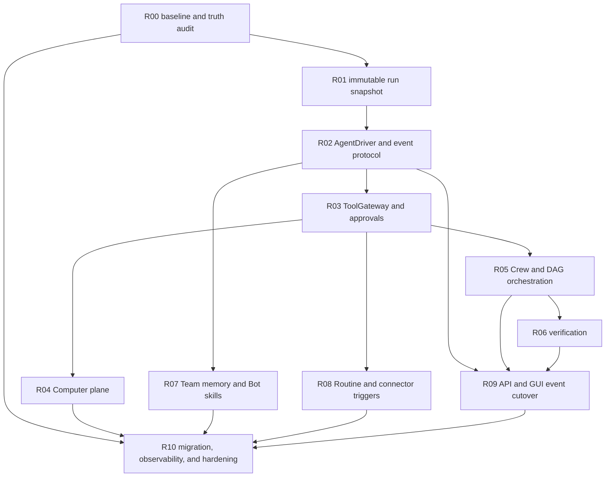

# Team / Bot Agent OS rebuild plan

Status: complete; implementation batches, cutover adapter, and verification evidence landed
Scope: rebuild the Team execution core on top of the existing canonical Team substrate

## First implementation batch

Implemented in the current working tree:

- R01 slice: all TeamService-created WorkRequests capture immutable agent revision,
  sandbox, scoped context, and connector-grant metadata before persistence; retries
  ignore only these derived snapshot fields when checking idempotency.
- R02 slice: TurnEngine events are normalized into a provider-neutral durable event
  vocabulary, reasoning deltas are excluded, sensitive payload fields are redacted,
  and normalized events are persisted before the existing live projections continue.
  The current TurnEngine is now behind an `AgentDriver` adapter with lifecycle
  operations for start, stream, resume, recover, and cancel.
- R03 slice: Team tool execution passes through a registry-compatible gateway that
  writes redacted audit metadata and an arguments hash before execution, then a
  terminal success/failure marker after it. Replays with an existing start or
  terminal marker stop for reconciliation instead of duplicating a possible side
  effect.

The initial batch is followed by the integration and cutover batches below. The
implementation is complete; the remaining two skips are opt-in live vision and
an intentionally undocumented crash hook that the chaos suite reports.

## Current integration batch

Implemented and covered in the current working tree:

- R03: pinned revisions that declare `durable_approval` (or
  `require_tool_approval`) now make high-risk Team tools create one deterministic,
  redacted approval at the final gateway boundary before execution. Pending
  approval parks the same run and releases its lease; approval reclaims the same
  delivery/run identity, while denial/expiry/cancel closes the parked run without
  a duplicate attempt. Existing revisions retain their legacy grant behavior
  until their approval policy is explicitly migrated.
- R04: Computer persistence and provider-neutral operations now cover Computer,
  ComputerSession, ScreenLease, and human takeover records. Dispatch snapshots
  persist an explicit Computer identity or no-Computer state. A lazy local
  Playwright provider, durable Computer routes, run-bound tools, reconnect, and
  same-run human takeover park/resume are wired through the canonical delivery
  lease; file transfer remains behind the sandbox file broker by design.
- R05: bounded CrewOrchestrator supports typed child-result envelopes, sender/run
  identity checks, depth/fan-out/handoff budgets, deterministic aggregation, and
  graph cancellation. Successful handoff runs project their typed result.
- R06: AcceptanceContract and independent VerificationService persist attempts,
  safe evidence, verifier identity, human-review gates, and runtime settlement
  checks.
- R07: Team memory candidates support scoped extraction, deduplication, explicit
  accept/reject, conflict detection, retention, and export; the runtime accepts
  an explicitly injected post-run extractor, while skill content/configuration
  snapshots are pinned with the request and treated as inert guidance.
- R08: Routine definitions and occurrence claims are durable and idempotent, and
  trigger through `submit_automation` rather than a private worker path. A
  claimed occurrence can recover after a crash without creating a duplicate
  WorkRequest.
- R09: typed command/query envelopes, safe API error envelopes, a duplicate-safe
  GUI event reducer, Team observability query plumbing, and Computer/Routine/
  Memory-candidate API routes are present.
- R10: read-only metrics and redacted run traces cover queue latency, retries,
  run/delivery/approval/verification states, tool events, and recovery signals.

Verification evidence for this batch is recorded below. The migration probe
fixtures now use IDs after the production migrations, and replay comparison
ignores derived Computer snapshots just like the other dispatch-time snapshots.

Final scoped evidence:

```text
Backend full repository: TMPDIR=<isolated /var/tmp> .venv/bin/pytest -q
  --basetemp=<isolated> tests
2171 passed, 1 skipped, 2 warnings
Backend post-fix Team/server slice: .venv/bin/pytest -q
  tests/test_multiroot.py tests/test_server.py tests/test_automation_team.py
  tests/test_team*.py
442 passed
GUI unit: npm test -- --run
165 passed across 25 files
GUI typecheck/build: npx tsc --noEmit; npm run build
passed
GUI Team E2E: CHOKIDAR_USEPOLLING=1 npx playwright test e2e/team.spec.ts
10 passed
GUI live API: COWORKER_STATE_DIR=/tmp/astra-state npx playwright test
  e2e-live/api-smoke.spec.ts --config=playwright.live.config.ts
2 passed
GUI Team surface: durable Computer projection included in the 20-test file
Computer runtime: `computer_request_takeover` parks and resumes the same run;
  one delivery/run remains durable; pass
Routine recovery: claimed occurrence re-submits through stable idempotency and
  returns one request/delivery; pass
GUI hermetic E2E: CHOKIDAR_USEPOLLING=1 npx playwright test --workers=1
  221 passed
GUI live smoke after a deliberate server restart:
  COWORKER_STATE_DIR=/tmp/astra-state npx playwright test
  --config=playwright.live.config.ts --reporter=line
  7 passed (API shape, approval, scratch artifact, Inbox projection,
  persistence/resume, and persona install/runtime).
```

The full Python repository gate is green after the scratch-boundary fix, and the
full hermetic GUI gate is green with Chromium installed. The remaining
full-rebuild gates are legacy parity/cutover evidence and the complete
crash/chaos matrix. These remaining gates are not claimed as shipped by this
batch.

## Outcome

Astra Team behaves like a persistent Agent Operating System:

```text
message / task / automation / connector / handoff
  -> durable WorkRequest
  -> deterministic routing and authorization
  -> pinned Bot revision and scoped context
  -> leased AgentExecution in an isolated Computer/Sandbox
  -> ToolGateway, approvals, delegation, and verification
  -> durable result, artifacts, memory, notifications, and trace
```

The product goal is not to copy Grok's UI or one open-source implementation. The
goal is to preserve the useful Team contracts already present and make the runtime
semantics real, durable, provider-neutral, and recoverable.

## Current baseline

The repository already has a substantial Team control plane:

- agent definitions, immutable revisions, installations, lifecycle, and per-agent
  sandboxes;
- direct/group conversations, threads, mentions, deterministic routing;
- `WorkRequest`, deliveries, leases, heartbeats, budgets, retry, cancellation,
  and durable output replay;
- capability binding, connector grants, external identities, secret leases,
  context scopes, artifacts, handoffs, and event cursor catch-up;
- canonical Team API routes and a GUI event reconnect helper.

The remaining execution risk is concentrated in the broad verification gate:
the canonical runtime now exposes the provider-neutral AgentDriver, ToolGateway,
Computer, approval, verification, memory, skill, and routine contracts, and the
live Chromium canary is green. `LegacyCutoverService` now provides a read-only
preflight, byte-preserving backup, idempotent import, mapping ledger, and verify
operation for legacy sessions, boards, chat, teams, and automations. The legacy
HTTP task/item board routes now switch through `LegacyBoardAdapter` only after
the durable cutover marker is activated. Auxiliary legacy board routes that do
not yet have canonical projections are explicitly fenced with `409` after
activation, so they cannot create a second source of truth.

Treat the existing `plan/done/` entries as work-in-progress claims until the
acceptance evidence below is produced. The working tree is already dirty; this
plan must not be implemented by reverting or mass-formatting unrelated changes.

## Keep, rebuild, and defer

### Keep as the foundation

- `coworker/teams/contracts.py`
- `coworker/teams/persistence.py`, with new migrations kept additive
- `coworker/teams/routing.py`
- `coworker/teams/coordinator.py`
- `coworker/teams/permissions.py`
- `coworker/teams/context.py`
- `coworker/teams/connectors.py` and external identity grants
- agent lifecycle/revision code in `coworker/teams/agents.py`
- durable event cursor/catch-up and the existing Team UI shell

### Rebuild or replace gradually

- `coworker/teams/runtime.py` into an execution kernel using AgentDrivers;
- capability invocation into one durable ToolGateway;
- approval handling into a run-aware durable state machine;
- sandbox-only execution into a Computer plane;
- handoff enqueueing into a Crew/DAG orchestrator with result aggregation;
- task review into an AcceptanceContract/verification layer;
- global/session skill and memory paths into Bot- and scope-aware Team services;
- legacy Team/Chat/Automation paths into adapters and then a controlled cutover.

### Deliberately defer

- replacing local-first SQLite with Postgres before concurrency and packaging
  evidence requires it;
- cloning a provider's private protocol or copying a prototype's UI;
- exposing raw chain-of-thought;
- building a second execution path for legacy automation or chat.

## Dependency graph



R04 and R05 may proceed in parallel after R03. R07 and R08 may proceed in
parallel after R02/R03. R09 must not become the source of truth for runtime state.

## Task breakdown

### R00 — Baseline, ownership, and truth audit

Depends on: none
Primary owner: architecture/integration

Scope:

- inventory the dirty worktree and identify which Team files are already owned by
  the current implementation effort;
- run the current Team/backend/GUI verification and record exact results;
- map every Agent OS primitive to its canonical owner, persistence record, API
  entry point, runtime caller, and test coverage;
- audit the existing T01–T15 plan claims against source and tests;
- create one gap matrix referenced by this plan, without creating a second target
  architecture document.

Acceptance:

- no task is marked complete solely because a class, table, route, or UI exists;
- every gap has a severity, owner, dependency, and acceptance test;
- the baseline preserves all pre-existing changes and secrets are absent from
  evidence output;
- the first implementation batch is R01, not a UI rewrite.

Suggested evidence:

```bash
.venv/bin/pytest -q tests/test_team*.py tests/test_automation_team.py
git status --short
git diff --check
```

### R01 — Immutable run snapshot and contract freeze

Depends on: R00
Primary owner: `coworker/teams/contracts.py`, `persistence.py`, `coordinator.py`

Scope:

- add an immutable dispatch snapshot to every run, not only automation work;
- persist agent revision, model settings, capability policy, connector grant
  snapshot, sandbox/computer snapshot, context snapshot, budget, and parent
  execution metadata;
- make `WorkRequest` and `Run` distinguish logical work, delivery, execution, and
  retry attempt;
- preserve additive migration and existing idempotency behavior;
- remove the interactive fallback to the installation's current revision once
  older requests have an explicit compatibility path.

Acceptance:

- editing or pausing a Bot after enqueue does not mutate a queued run's behavior;
- retries use the same logical snapshot and do not silently pick a new revision;
- duplicate client idempotency keys return the original logical request;
- fresh database, upgrade database, restart, and migration-crash tests pass;
- a run can be inspected without reconstructing state from transient WebSocket
  events.

### R02 — Provider-neutral AgentDriver and canonical execution events

Depends on: R01
Primary owner: new `coworker/teams/drivers.py` and `execution_events.py`, then
`runtime.py`

Scope:

- define an `AgentDriver` SPI with `start`, `stream`, `resume`, `cancel`, and
  `recover` operations;
- wrap the current `TurnEngine` as the first adapter instead of making it the
  canonical Team contract;
- normalize provider output into durable events for runs, agents, content, tools,
  handoffs, approvals, computers, artifacts, and terminal states;
- persist event sequence before broadcasting it to the GUI;
- keep event payloads safe: no raw chain-of-thought, credentials, cookies, or
  unrestricted provider transcripts.

Acceptance:

- a fake deterministic driver can run a complete request without a real model;
- a provider error cannot advance delivery to acknowledged/succeeded;
- reconnect from any event cursor replays the missing suffix exactly once to the
  reducer;
- a crashed worker can resume or settle a run from durable events;
- adding another provider does not require changing routing, policy, or GUI state
  semantics.

### R03 — ToolGateway, ToolExecution, and durable approvals

Depends on: R02
Primary owner: new `coworker/teams/tool_gateway.py`, `capabilities.py`,
`permissions.py`, `persistence.py`

Scope:

- route every Team tool through:

  ```text
  resolve -> authority intersection -> risk -> approval/grant
  -> durable ToolExecution -> execute -> audit/result
  ```

- add durable tool execution records with run, requester, agent, workspace,
  target, arguments hash, idempotency key, status, and result reference;
- connect tool risk to the existing approval repository and `waiting_approval`
  run state;
- treat revision capability installation as an allowlist/ceiling, not implicit
  approval for each consequential action;
- support approve, deny, expire, cancel, retry, and resume semantics;
- keep connector grants and secret broker checks inside the same gateway;
- define an explicit `unknown/reconcile` state for a side effect that may have
  happened before a worker crash. Do not claim exactly-once execution.

Acceptance:

- a high-risk tool creates one durable approval and parks the run;
- double-clicking approval never creates two executions;
- restart while waiting for approval resumes the same logical run;
- approval for one exact target/argument scope cannot authorize another;
- denied/expired approval produces a visible terminal or resumable state;
- sensitive values never appear in model context, events, audit text, or errors.

### R04 — Computer plane and human takeover

Depends on: R03
Primary owner: new `coworker/teams/computer.py`, `sandbox.py`, migrations,
`surfaces/gui/src/components`

Scope:

- introduce `Computer`, `ComputerSession`, `ScreenLease`, and
  `TakeoverRequest` records;
- extend the provider boundary with provision/reconnect/suspend/destroy,
  observe/screenshot, browser actions, file transfer, and checkpoint operations;
- keep the existing local sandbox explicitly labeled as weak isolation;
- implement a first browser provider using an isolated Playwright/browser
  session; leave remote desktop providers behind the same interface;
- add human takeover for password, MFA, CAPTCHA, or any action requiring a
  human-only floor;
- ensure a screen lease is exclusive and recoverable after disconnect.

Acceptance:

- every persistent Bot has a separately owned Computer or an explicit
  no-computer capability state;
- browser screenshot/navigation/action works through the durable run path;
- killing and reconnecting a Computer does not lose the parent run;
- only one actor holds a screen lease at a time;
- takeover transitions `waiting_human -> resumed` without exposing secrets to the
  model;
- Computer events are audited and visible through the same event stream.

### R05 — Crew runtime, structured handoff, and DAG scheduling

Depends on: R03
Primary owner: `coordinator.py`, `persistence.py`, new `orchestrator.py`

Scope:

- turn `CrewRun`, task dependencies, and handoffs into an actual execution graph;
- make the runtime, not the model or UI, enforce readiness, fan-out, fan-in,
  maximum depth, maximum handoffs, active-agent limits, and budgets;
- create child `WorkRequest`/Run records for structured handoffs;
- return a typed child result envelope containing status, summary, artifacts,
  evidence, and failure reason to the parent;
- bind sender identity to the currently running agent/run; distinguish a human
  scheduling a task from an agent issuing a handoff;
- propagate cancellation, timeout, retry, and lease recovery through the graph.

Acceptance:

- A can hand off to B and B actually executes in its own sandbox/Computer;
- B's durable result reaches A without parsing free-form chat;
- A -> B -> A and other cycles are blocked before execution;
- parallel children obey fan-out/budget limits and aggregate deterministically;
- canceling a parent cancels or settles all descendants;
- a task with incomplete dependencies cannot be claimed by a worker;
- builder and verifier roles remain independent for protected tasks.

### R06 — AcceptanceContract and independent verification

Depends on: R05
Primary owner: new `coworker/teams/verification.py`, task/run repositories

Scope:

- define acceptance contracts for coding, research, browser, connector, and
  multi-agent work;
- support checks for tests, files, schemas, screenshots, artifacts, browser
  state, and required human review;
- persist verification attempts, evidence, verifier identity, and failure details;
- allow a dedicated verifier agent or human reviewer, never self-approval by the
  builder;
- make terminal success depend on the declared contract, not solely on a model
  response saying “done”.

Acceptance:

- a run with missing evidence cannot become verified/succeeded;
- verification failure preserves outputs and returns the task to a clear state;
- verifier evidence is linked to the exact run/revision/artifacts;
- protected task review rejects the builder as reviewer;
- human override is explicit, authorized, audited, and never model-controlled.

### R07 — Team-scoped memory and Bot-bound skills

Depends on: R02 and R03
Primary owner: `context.py`, Team persistence, `coworker/skills`, new memory
service

Scope:

- implement private Bot, DM, group, task, workspace, and run-scratch scopes;
- add post-run memory candidate extraction, deduplication, conflict handling,
  importance, retention, delete, export, and audit;
- bind skill manifests/version/config to an AgentRevision or explicit installation
  policy;
- keep Skill as “how” and Routine as “when”;
- treat retrieved memory and skill content as data/reference, never as a source of
  permission or authority;
- preserve explicit DM-to-group sharing through `ContextShare`.

Acceptance:

- DM content cannot enter group context without an explicit authorized share;
- changing a skill revision does not alter an already queued run;
- memory deletion/export respects scope and provenance;
- prompt injection in memory/skill text cannot expand permissions or recipients;
- the same Bot can be tested with empty, partial, and full memory contexts.

### R08 — First-class Routine and connector-trigger execution

Depends on: R02 and R03
Primary owner: automation bridge, new Team Routine repository/service,
`connectors.py`

Scope:

- define Routine with schedule/event trigger, timezone, target Bot/conversation,
  instruction, budget, approval policy, and lifecycle;
- generate a stable occurrence idempotency key for every scheduled execution;
- adapt the existing scheduler instead of creating a second worker path;
- make connector inbound events persist first, then route through the canonical
  WorkRequest flow;
- keep connector outbound delivery behind ToolGateway/grant/audit and make retry
  behavior explicit.

Acceptance:

- scheduler restart does not duplicate an occurrence;
- pause/resume, missed schedule, timezone, and manual trigger semantics are
  tested;
- connector event retries are idempotent and preserve external identity scope;
- outbound send never bypasses a revoked grant;
- legacy automation history is only a projection, never a second source of truth.

### R09 — Typed API contract and GUI projection cutover

Depends on: R02, R05, and R06
Primary owner: `api_contracts.py`, `server/app.py`, `surfaces/gui/src/api.ts`,
`TeamSurface.tsx`

Scope:

- make command routes parse/validate `CommandEnvelope` and query routes parse
  `QueryEnvelope`;
- standardize authorization, idempotency conflict, stale revision, retryable
  error, denied, and offline/reconnect responses;
- make GUI consume REST/query state plus one canonical event reducer;
- project run/tool/approval/computer/handoff/artifact state without making the UI
  decide readiness, permission, completion, or ownership;
- cover loading, empty, partial, full, offline, denied, error, and recovery
  states.

Acceptance:

- refresh during a run reconstructs the same state from durable queries/events;
- reconnect catches up without duplicated messages or status transitions;
- invalid envelopes fail with safe typed errors;
- UI controls cannot grant a permission that backend policy denies;
- all Team entry points remain mapped to one canonical WorkRequest pipeline.

### R10 — Legacy migration, observability, chaos, and cutover

Depends on: all previous tasks
Primary owner: integration/release

Scope:

- import and parity-check `TeamRegistry`, `ChatStore`, `TeamStore`, legacy board
  routes, session-based wake paths, and automation projections;
- move legacy reads to adapters first, then move writes to canonical Team;
- prevent dual execution while compatibility routes remain available;
- only remove legacy paths after migration, restart, crash, and data parity tests;
- add trace trees for parent/child/tool/approval/computer execution;
- add metrics for queue latency, lease expiry, retries, budget exhaustion,
  approval wait, verification failure, and connector delivery;
- run the full safety/chaos/topology/live-canary matrix.

Acceptance:

- existing conversations, automations, boards, artifacts, and connector bindings
  survive migration;
- crash injection at every delivery/run/tool/approval transition yields no silent
  loss and no unreported duplicate side effect;
- every background action has owner, budget, stop path, trace, and audit record;
- no secret or credential appears in logs, fixtures, screenshots, or event
  payloads;
- legacy and canonical paths have one source of truth before deletion;
- Team is not publicly treated as complete until the complete gate passes.

## Completion gates

The rebuild is complete only when all of these are true:

- every run uses a pinned Bot revision and scoped context/computer snapshot;
- DM, group, task, automation, connector, and handoff converge on one
  `WorkRequest` pipeline;
- permissions are the backend intersection of requester, workspace, Bot role,
  capability, connector, task, sandbox/computer, and approval;
- risky tools have durable approval and idempotent/recoverable execution;
- Computer/browser actions support reconnect and human takeover;
- delegation produces real child executions with bounded graph semantics;
- verification evidence is required where the task declares it;
- memory, skills, routines, connectors, notifications, and GUI are projections of
  durable Team state;
- at-least-once delivery, duplicate side effects, crash recovery, cancellation,
  budget exhaustion, and lease expiry are tested explicitly;
- Python, GUI, migration, chaos, and relevant live canary suites pass;
- `git diff --check` passes and the final diff contains no unexplained changes.

R10 evidence currently landed:

- `.venv/bin/pytest -q tests/test_team_cutover.py tests/test_legacy_board_adapter.py`:
  `6 passed`;
- `.venv/bin/pytest -q tests/test_server.py tests/test_team_open_surface.py`:
  `108 passed`;
- `.venv/bin/pytest -q tests --basetemp=<temp-outside-repo> --maxfail=1`:
  `2184 passed, 2 skipped, 2 warnings`;
- `.venv/bin/pytest -q tests/test_team_chaos.py`: `7 passed, 1 skipped` (the
  skip is the documented missing pre-approval side-effect crash hook);
- prior GUI evidence: unit `165/165`, TypeScript/build pass, hermetic E2E
  `221 passed`, live API `2 passed`, and live smoke `7 passed`;
- the authenticated `/v1/team/cutover` API exposes read-only preflight and
  confirmation-gated import/verify without deleting legacy data; activation
  is durable and board HTTP compatibility is covered by the route test.

## Recommended first implementation batch

Implement only R00, then R01 and R02. This establishes the truth baseline, pins
run behavior, and creates the event/driver boundary. R03 should follow before any
new high-risk tool, browser flow, or multi-agent UI is exposed.
